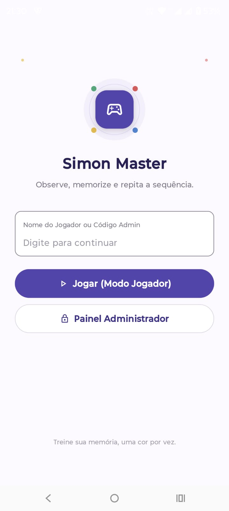
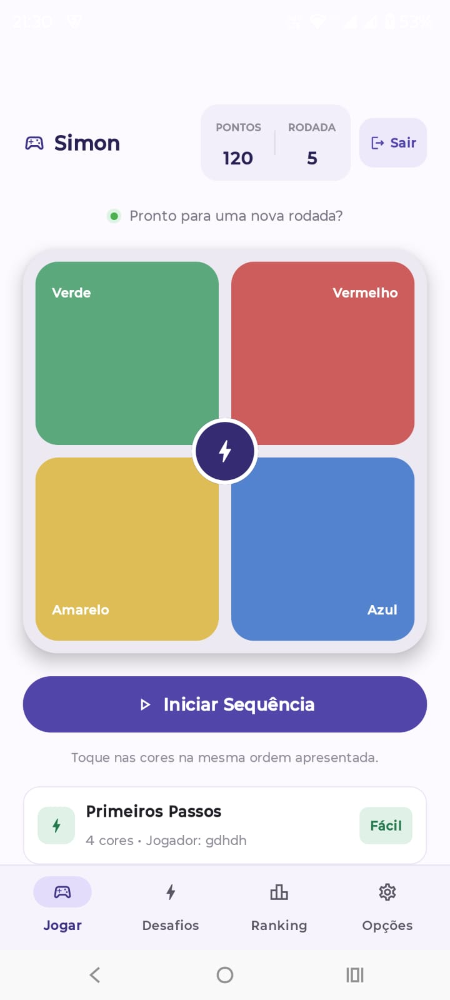
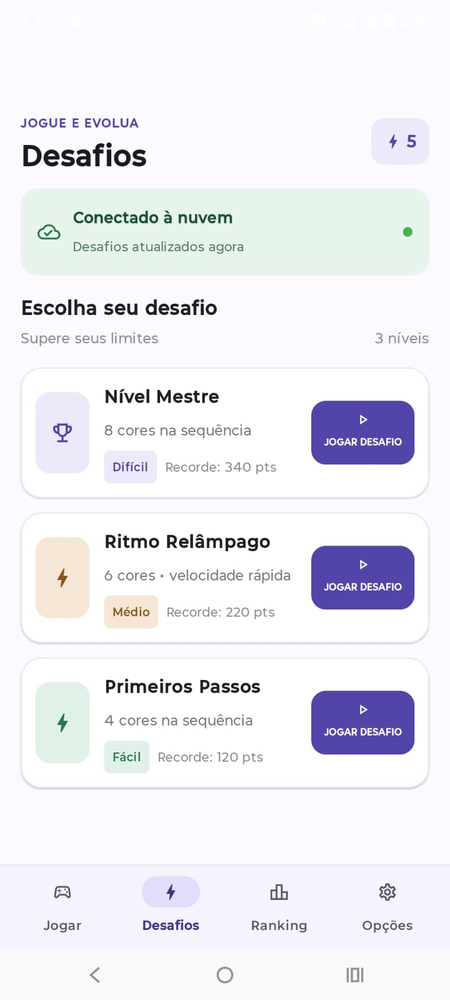
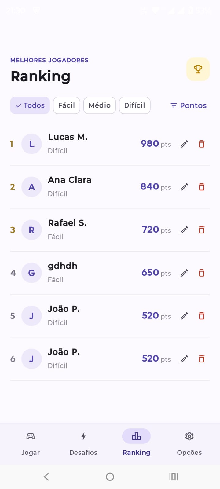
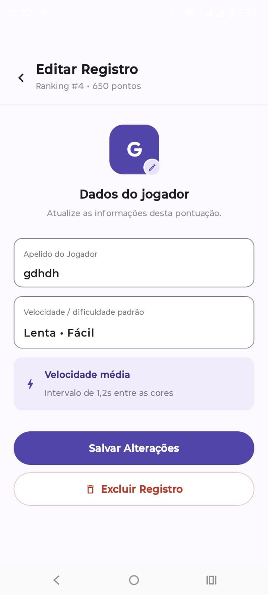
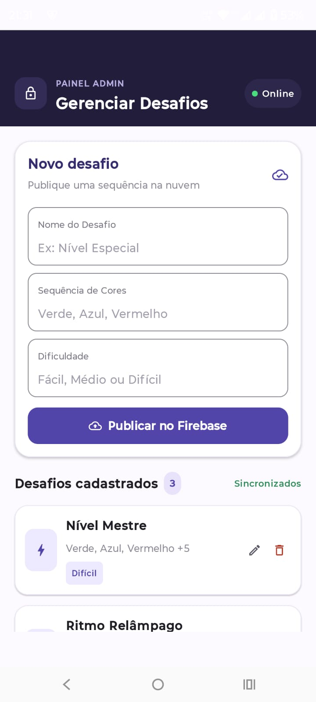

# 🎮 Simon Master — Jogo Decifrador de Padrões Sequenciais

Aplicativo Android nativo desenvolvido em **Kotlin** e **Jetpack Compose**, aplicando a **Arquitetura MVVM (Model-View-ViewModel)** com **Persistência Local Reativa (Room Database)** e **Sincronização em Nuvem (Firebase Cloud Firestore)**.

---

## 📌 Sobre o Projeto e Tema

O **Simon Master** é um mini-jogo de lógica e memória visual inspirado no clássico *Simon Says*. O jogador deve observar, memorizar e repetir sequências progressivas de cores (**Verde, Vermelho, Amarelo e Azul**) dentro da velocidade configurada para cada nível de dificuldade (**Fácil, Médio ou Difícil**).

O sistema possui **controle e bifurcação de acesso por perfil**:
- **Modo Jogador**: Permite identificar o jogador, disputar partidas no tabuleiro interativo do Simon, escolher desafios sincronizados da nuvem, consultar o Ranking filtrável/ordenável em tempo real, editar configurações de perfil/velocidade, excluir seu registro ou alternar de perfil pelo botão **Sair**.
- **Modo Administrador (Painel Admin)**: Área restrita (acessada via código `admin` / `1234` ou botão dedicado na tela inicial) que funciona como um *Dashboard de Gerenciamento de Conteúdo*, permitindo realizar o **CRUD Completo** (Criar, Ler, Atualizar e Excluir) da base mestra de desafios diretamente no **Firebase Cloud Firestore** com sincronização local no **Room Database**.

---

## 🎥 Vídeo de Demonstração

> **[Inserir Link do Vídeo Aqui]**  
> *Espaço reservado para o link ou embed do vídeo demonstrando o aplicativo funcionando (fluxo do Modo Jogador, Ranking Local Room e sincronização em tempo real do Painel Admin com o Firebase Firestore).*
>
> 🔗 **Link do Vídeo:** `[https://www.canva.com/design/DAHbINb5EPE/ox2UDJhXXxKcjyyWjDWFeQ/edit]`

---

## 📱 Capturas de Tela (Screenshots)

| Tela 01 — Login e Seleção de Perfil | Tela 02 — Tabuleiro do Jogo (Simon) | Tela 03 — Desafios na Nuvem |
| :---: | :---: | :---: |
| <br>*(Tela Inicial: Modo Jogador vs. Painel Admin)* | <br>*(Jogo Simon: Sequência de Cores, Pontos e Rodada)* | <br>*(Lista de Desafios Sincronizados com o Firebase)* |

| Tela 04 — Ranking de Jogadores | Tela 05 — Editar Registro / Opções | Tela 06 — Painel Administrador (CRUD) |
| :---: | :---: | :---: |
| <br>*(Ranking Reativo Room com Filtros e Ordenação)* | <br>*(Edição de Apelido/Velocidade e Excluir Registro)* | <br>*(Gerenciamento de Desafios no Firebase Firestore)* |

---

## 🏗️ Arquitetura MVVM e Modularização

O código foi estruturado seguindo os princípios de **Clean Architecture / MVVM** e **Unidirectional Data Flow (UDF)**, dividido em pacotes lógicos bem definidos:

```text
com.example.myapplication/
├── data/
│   ├── local/          # AppDatabase.kt, DesafioDao.kt, RankingDao.kt (Room SQLite)
│   ├── model/          # DesafioEntity.kt (Entidade 1) e RankingEntity.kt (Entidade 2)
│   ├── remote/         # FirebaseSource.kt (Integração com o Cloud Firestore)
│   └── repository/     # DesafioRepository.kt e RankingRepository.kt (Single Source of Truth + try-catch)
├── ui/
│   ├── navigation/     # AppNavigation.kt (NavHost com 6 rotas + Bottom Navigation Bar)
│   ├── screens/        # 6 Telas em Jetpack Compose (Login, Simon, Desafios, Ranking, EditarRegistro, Admin)
│   ├── theme/          # Color.kt, Theme.kt, Type.kt
│   └── viewmodel/      # 6 ViewModels independentes + 6 UiStates imutáveis + AppViewModelFactory.kt
└── MainActivity.kt     # Ponto de entrada e injeção de dependências
```

### Os 6 ViewModels e 6 UiStates Independentes

Cada uma das 6 telas do aplicativo possui seu próprio `ViewModel` e sua própria `data class UiState` imutável exposta via `StateFlow`:

| # | Tela (`ui.screens`) | ViewModel (`ui.viewmodel`) | Estado (`ui.viewmodel`) | Responsabilidade Principal |
| :-: | :--- | :--- | :--- | :--- |
| **01** | `LoginScreen.kt` | `LoginViewModel.kt` | `LoginUiState.kt` | Bifurcação de perfil (Jogador vs. Admin), vínculo e logout (`sairDoPerfil`) do jogador ativo. |
| **02** | `SimonScreen.kt` | `SimonViewModel.kt` | `SimonUiState.kt` | Motor do jogo Simon, reprodução temporizada das cores, validação de jogadas e atualização de recordes. |
| **03** | `DesafiosScreen.kt` | `DesafiosViewModel.kt` | `DesafiosUiState.kt` | Listagem reativa dos desafios sincronizados com o Firebase e seleção de desafio ativo para jogar. |
| **04** | `RankingScreen.kt` | `RankingViewModel.kt` | `RankingUiState.kt` | Observação reativa do placar no Room com filtros por dificuldade (`.filter`) e ordenação por pontos (`.sortedBy` / `.sortedByDescending`). |
| **05** | `EditarRegistroScreen.kt` | `EditarRegistroViewModel.kt` | `EditarRegistroUiState.kt` | Atualização de apelido e velocidade padrão no Room, além de exclusão do registro com retorno imediato à tela de Login. |
| **06** | `AdminScreen.kt` | `AdminViewModel.kt` | `AdminUiState.kt` | CRUD completo de desafios sincronizados entre o Room e a coleção `"desafios"` no Firebase Firestore. |

> **Injeção de Dependências (`AppViewModelFactory.kt`)**: Implementa `ViewModelProvider.Factory` para injetar manualmente `RankingRepository` e `DesafioRepository` nos 6 ViewModels.

---

## 💾 Persistência de Dados: Room (2 Entidades) + Firebase Firestore

### 1. Persistência Local com Room Database (`simon_master_database`)
O banco de dados local (`AppDatabase.kt`) utiliza **2 tabelas distintas (`@Entity`)** com exposição reativa via **`Flow<List<...>>`** e **CRUD Completo**:
- **Entidade 1 — `DesafioEntity` (`desafios_table`)**: Armazena localmente os desafios (`id`, `titulo`, `sequenciaCores`, `dificuldade`, `recordePts`, `velocidadeMs`) gerenciados pelo `DesafioDao`, atuando como cache *Offline-First* sincronizado com o Firebase.
- **Entidade 2 — `RankingEntity` (`ranking_table`)**: Armazena o placar e as preferências dos jogadores (`id`, `apelido`, `dificuldade`, `velocidadePadrao`, `pontos`) gerenciados pelo `RankingDao`.

### 2. Integração Externa com Firebase Cloud Firestore
- **Projeto Firebase**: `golden-bloom-377322` (configurado via `app/google-services.json`, `firestore.rules` e `firestore.indexes.json`).
- **Coleção Remota**: `"desafios"` (gerenciada em `FirebaseSource.kt` usando `FirebaseFirestore.getInstance()`, `Tasks.await` e `Dispatchers.IO`).
- **Resiliência e Tratamento de Exceções**: Os repositórios (`DesafioRepository` e `RankingRepository`) utilizam blocos `try-catch` e `Result<T>` para isolar falhas de rede/banco e expor mensagens amigáveis no `errorMessage` de cada `UiState`.

---

## 🛠️ Tecnologias Utilizadas

- **Linguagem**: Kotlin (`2.2.10`) com Coroutines, `Flow` / `StateFlow` e funções de alta ordem (`map`, `filter`, `sortedBy`, `sortedByDescending`)
- **Interface (UI)**: Jetpack Compose + Material Design 3 + Navigation Compose (`NavHost` + `Bottom Navigation Bar`)
- **Arquitetura**: MVVM + Unidirectional Data Flow (UDF) + Repository Pattern + `ViewModelProvider.Factory`
- **Banco de Dados Local**: AndroidX Room (`2.8.5`) com KSP
- **Nuvem / Backend**: Firebase Cloud Firestore (`firebase-bom: 34.4.0`)

---

## 🚀 Como Executar o Projeto

1. Clone este repositório:
   ```bash
   git clone https://github.com/davyd9/Ultimo-projeto.git
   ```
2. Abra a pasta do projeto no **Android Studio**.
3. Aguarde a sincronização do **Gradle** (o arquivo `app/google-services.json` já está configurado no módulo `:app`).
4. Execute o aplicativo em um emulador ou dispositivo físico Android (**API 26 / Android 8.0** ou superior):
   - Para entrar no **Modo Jogador**, digite seu apelido e toque em **"Jogar (Modo Jogador)"**.
   - Para acessar o **Painel Administrador**, toque em **"Painel Administrador"** ou digite `admin` (ou `1234`) no campo inicial.
